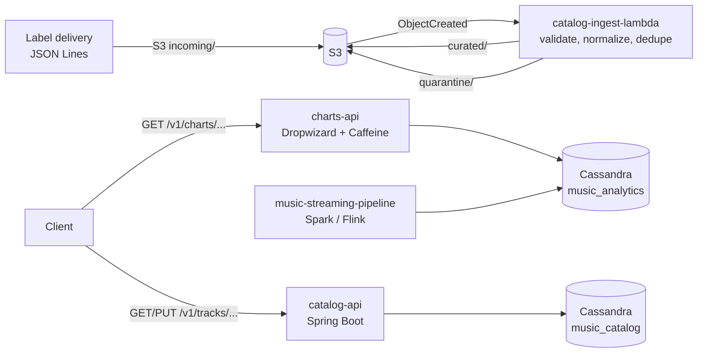

# Music Catalog Services

Java microservices that **serve** music data at low latency. A charts API exposes the real-time
and daily charts produced by the
[music-streaming-pipeline](../music-streaming-pipeline). A catalog API manages track and artist
metadata. A serverless function ingests label catalog deliveries from S3.

**Stack:** Java 17 · Dropwizard · Spring Boot · AWS Lambda (SAM, SnapStart) · Amazon S3 ·
Apache Cassandra (DataStax Java driver, Spring Data Cassandra) · Caffeine · Micrometer/Prometheus
· Docker · Kubernetes (HPA, probes, zone spreading) · Gradle · GitHub Actions



## Services

### `charts-api` (Dropwizard)

| Endpoint | Description |
|---|---|
| `GET /v1/charts/trending/{country}?limit=50` | "Trending now" from the latest 10-minute sliding window |
| `GET /v1/charts/daily/{country}/{date}` | Daily top chart, pre-ranked by the batch job |
| `GET /v1/tracks/{trackId}/daily-stats?days=30` | Streams, unique listeners and skip rate per day |

* **Fast reads.** Each endpoint is one single-partition Cassandra read on a prepared statement.
  The driver uses token-aware routing and speculative execution to cut tail latency.
* **Caching.** Charts are identical for every user in a country, so a Caffeine cache with a short
  TTL limits Cassandra to about one read per country per TTL, whatever the request rate.
* **Operations.** `@Timed` metrics on every endpoint, a Cassandra health check that drives the
  Kubernetes readiness probe, JSON logging, and config overrides through environment variables.

### `catalog-api` (Spring Boot)

| Endpoint | Description |
|---|---|
| `GET /v1/tracks/{trackId}` | Track metadata (cached) |
| `PUT /v1/tracks/{trackId}` | Upsert with Bean Validation (ISRC format, duration bounds) |
| `GET /v1/artists/{artistId}` | Artist metadata |
| `GET /v1/artists/{artistId}/tracks?limit=50` | Artist's tracks, newest first |

* **Query-driven data model.** `tracks` and `tracks_by_artist` are written together in a
  **logged batch**. If an update changes a track's partition or clustering key, the stale row is
  deleted in the same batch.
* **Error responses.** RFC 7807 `ProblemDetail` errors.
* **Observability.** Actuator liveness/readiness probes and Prometheus metrics.

### `catalog-ingest-lambda` (AWS Lambda)

Triggered when a file lands under `s3://<bucket>/incoming/`. It:

* normalizes ISRCs
* derives deterministic track ids, so re-delivering a file is idempotent
* deduplicates within the file
* writes clean records to `curated/` and rejected lines (with line number and reason) to
  `quarantine/`

Output keys are derived from the input key, so S3's at-least-once event delivery can't create
duplicates. It's deployed with the SAM template in
[`catalog-ingest-lambda/template.yaml`](catalog-ingest-lambda/template.yaml), with SnapStart
turned on to cut Java cold starts.

## Run locally

Prerequisites: JDK 17+ and Docker. Gradle comes with the wrapper.

```bash
./gradlew build                 # compile, test, build fat jars + Lambda zip
docker compose up -d --build    # Cassandra + both APIs

curl localhost:8080/v1/charts/trending/US?limit=10
curl -X PUT localhost:8090/v1/tracks/t000001 -H 'Content-Type: application/json' \
  -d '{"isrc":"USRC17607839","title":"Song","artistId":"a00001","durationMs":210000,"releaseDate":"2026-09-01","genres":["pop"]}'
curl localhost:8090/v1/artists/a00001/tracks
```

## Deploy

```bash
kubectl apply -k k8s/                                   # APIs: Deployment + Service + HPA
cd catalog-ingest-lambda && sam deploy --guided         # Lambda + S3 trigger
```

## Tests

```
charts-api             6 tests  ranking + tie-breaks, cache hit behaviour, input validation (400s), date math
catalog-api            5 tests  MockMvc: 200/404 ProblemDetail, validation rejects bad ISRC, bounded limits
catalog-ingest-lambda  5 tests  ISRC normalization, last-wins dedupe, quarantine reasons, idempotent keys
```
